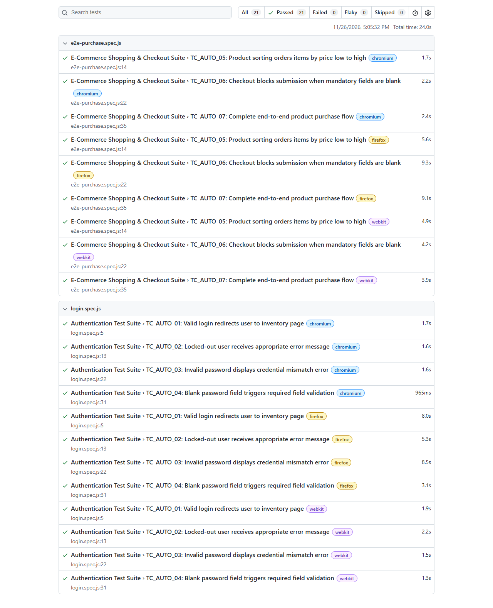

# End-to-End UI Test Automation Framework — SauceDemo

A cross-browser UI test automation framework built with **Playwright** and **JavaScript**, structured using the **Page Object Model (POM)** design pattern and integrated with **GitHub Actions CI/CD**.

## Framework Architecture
```text
saucedemo-playwright-automation/
├── .github/workflows/
│   └── playwright.yml        # Automated CI test execution on push/pull request
├── pages/
│   ├── LoginPage.js          # Locators & actions for authentication
│   ├── InventoryPage.js      # Locators & actions for sorting and cart management
│   └── CheckoutPage.js       # Locators & actions for checkout steps
├── tests/
│   ├── login.spec.js         # Positive & negative login test suite
│   └── e2e-purchase.spec.js  # Sorting, cart updates, validation & E2E checkout
├── playwright.config.js
└── package.json
```

## Automated Test Coverage (21 Executions Across 3 Browsers)

| Test ID | Test Scenario | Browsers Covered | Status |
| :--- | :--- | :--- | :--- |
| `TC_AUTO_01` | Valid login redirects to inventory page | Chromium, Firefox, WebKit | Pass |
| `TC_AUTO_02` | Locked-out user error validation | Chromium, Firefox, WebKit | Pass |
| `TC_AUTO_03` | Invalid password error validation | Chromium, Firefox, WebKit | Pass |
| `TC_AUTO_04` | Blank password required field validation | Chromium, Firefox, WebKit | Pass |
| `TC_AUTO_05` | Product sorting by price (Low to High) | Chromium, Firefox, WebKit | Pass |
| `TC_AUTO_06` | Checkout mandatory field validation | Chromium, Firefox, WebKit | Pass |
| `TC_AUTO_07` | End-to-end cart management & order completion | Chromium, Firefox, WebKit | Pass |

## HTML Test Report Proof



## How to Run Locally

1. Clone the repository:

   ```bash
   git clone https://github.com/<your-username>/saucedemo-playwright-automation.git
   ```

2. Install dependencies and Playwright browsers:

   ```bash
   npm install
   npx playwright install
   ```

3. Run all tests:

   ```bash
   npx playwright test
   ```

4. View the HTML report:

   ```bash
   npx playwright show-report
   ```
